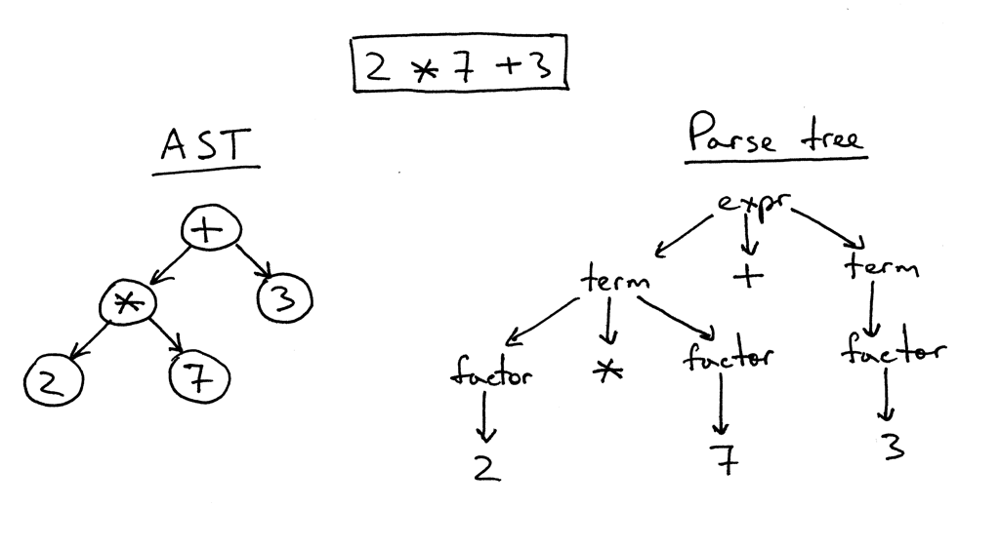

# scheme.cpp 🌱

Интерпретатор языка Scheme, на C++23.

Он превращает исходный код в токены, строит AST, вычисляет выражения и сохраняет
состояние между вызовами. Внутри - рекурсивный спуск, лексические окружения,
замыкания и классический REPL.

> Это не полная реализация стандарта Scheme

## Быстрый пример

```scheme
>>> (define (square x) (* x x))
()
>>> (square 12)
144

>>> (define make-counter
      (lambda (x)
        (lambda ()
          (set! x (+ x 1))
          x)))
()
>>> (define counter (make-counter 40))
()
>>> (counter)
41
>>> (counter)
42


; числа фиббоначи на scheme
>>> (define (fib n)
        (if (= n 0) 0
        (if (= n 1) 1
        (+ (fib (- n 1))
            (fib (- n 2))))))
()
>>> (fib 10)
55
```

### Возможности

- целые числа, булевы значения и символы;
- пары, правильные и неправильные списки;
- арифметические операции и сравнения;
- `quote`, `if`, `and` и `or`, `set-car!`, `set-cdr!`, `define`, `set!`;
- лямбда-функции, лексические области видимости и замыкания;
- рекурсивные функции;
- REPL;

### Как это работает
[Wiki](https://en.wikipedia.org/wiki/Scheme_(programming_language))

Строим AST (Abstract Syntax Tree) и вычисляем выражение


## Сборка и запуск

Необходим CMake 3.20+ и C++23.

```bash
cmake -S . -B build -DBUILD_TESTING=OFF
cmake --build build
./build/scheme-repl
```

Теперь можно вычислять выражения:

```scheme
>>> (+ 1 (* 2 3))
7
```

## Тесты

Тесты используют Catch2 3. Если библиотека установлена и доступна CMake:

```bash
cmake -S . -B build -DBUILD_TESTING=ON
cmake --build build
ctest --test-dir build --output-on-failure
```
